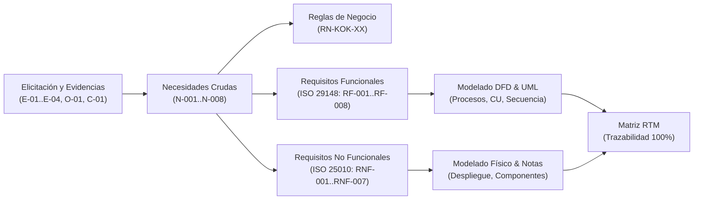
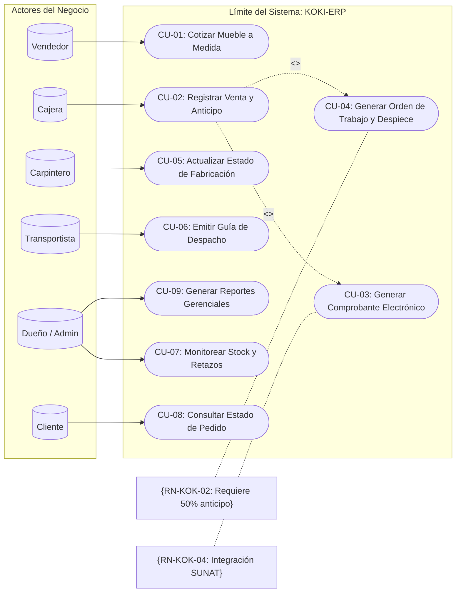
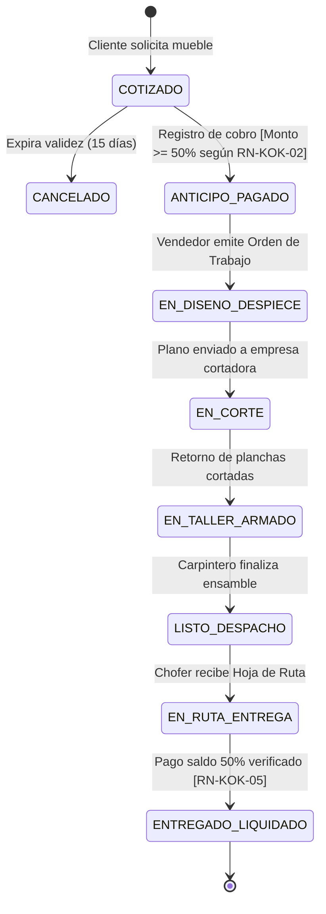
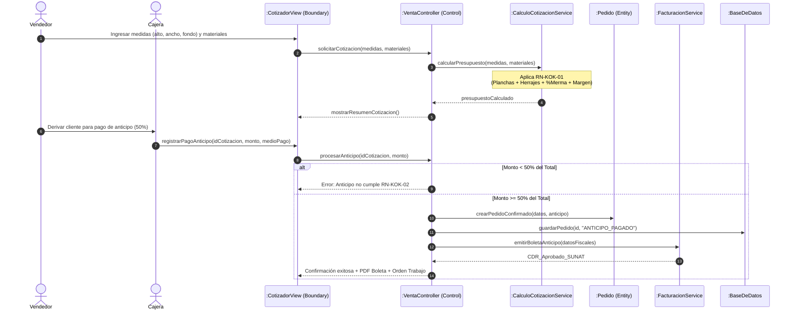
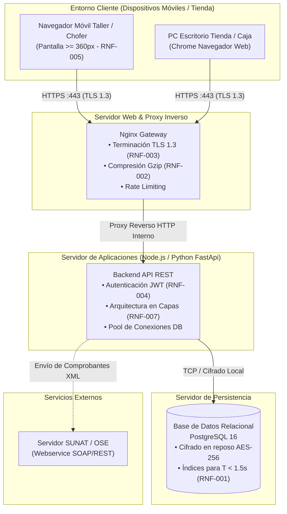

# ESQUEMA MAESTRO DE INGENIERÍA DE REQUISITOS Y MODELADO
## Sistema de Gestión Integral para la Empresa «KOKI MUEBLES»

**Estándares de Referencia:**  
* **ISO/IEC/IEEE 29148:2018:** *Requirements Engineering* (Sintaxis, verificación y criterios de calidad).  
* **ISO/IEC 25010:2023:** *Product Quality Model* (Cuantificación medible de atributos de calidad).  
* **BABOK v3:** *Elicitation, Traceability & Business Analysis*.  
* **OMG UML 2.5.1:** *Unified Modeling Language Specification*.  
* **RUP + Scrum:** Metodología híbrida (Fases RUP con entregas por Sprints).

---

## 1. ESTRATEGIA DE ARRANQUE: METODOLOGÍA DE INGENIERÍA

Para transformar las notas informales y entrevistas dispersas en un documento de especificación formal y trazable, el proceso sigue el siguiente flujo de cuatro capas:

---

## 2. COMPLETADO Y CIERRE DE LA FICHA DEL SISTEMA (LÍMITES)

A partir del análisis del problema detectado en el taller y tienda, se formaliza la delimitación del proyecto:

| Campo Metodológico | Definición Formal para Koki Muebles |
| :--- | :--- |
| **Nombre del Sistema** | **KOKI-ERP/MES:** Sistema Web de Gestión de Ventas, Cotizaciones Técnicas, Inventario y Control de Producción de Muebles a Medida. |
| **Organización / Contexto** | Mueblería Koki (Tacna, Perú) — Venta presencial/WhatsApp, diseño a medida en melamina, corte externalizado y armado en taller propio. |
| **Proceso Principal (Core)** | **Gestión del Ciclo de Vida del Pedido a Medida:** Cotización paramétrica $\rightarrow$ Anticipo y Orden de Fabricación $\rightarrow$ Despiece y Envío a Corte $\rightarrow$ Armado $\rightarrow$ Despacho y Liquidación. |
| **Alcance Inicial (In Scope)** | • Módulo de cotizaciones paramétricas (dimensiones, planchas, herrajes, servicios, mallas y margen). • Registro y validación de cobro de anticipos (50%) y emisión de comprobantes (Boleta/Factura SUNAT). • Generación de Fichas Técnicas de Despiece y planos para carpinteros y empresa cortadora. • Alertas de stock mínimo en insumos críticos (melamina, bisagras, correderas, luces LED). • Panel de seguimiento de estados del pedido accesible por rol. |
| **Fuera de Alcance (Out of Scope)** | • Maquinado directo asistido por computadora (CNC/CAD automático). • Geolocalización en tiempo real satelital de transportistas (se resolverá con registro de entregas móvil). • Pasarela de pagos internacionales (se limitará a transferencias, Yape/Plin, POS y efectivo en PEN). |

---

## 3. FORMALIZACIÓN DE NECESIDADES CRUDAS Y EVIDENCIAS

Se unifican y cierran las 8 necesidades del negocio con su respectivo código de evidencia trazable:

| ID | Stakeholder | Expresión de Necesidad Cruda | Evidencia / Origen | Problema Mitigado |
| :---: | :--- | :--- | :---: | :--- |
| **N-001** | ST-001 (Dueño) | Centralizar el control de ingresos y egresos eliminando el cuaderno físico. | E-01 (Preg. 11, 12) | Cuadernos extraviados, desfase de caja y ventas informales no contabilizadas. |
| **N-002** | ST-002 (Caja/Contador) | Agilizar el cobro y comprobantes sin duplicar registros entre caja y SUNAT. | E-01 (Preg. 2, 11) | Sobrecarga de la cajera, doble registro manual y errores en montos de vuelto. |
| **N-003** | ST-003 (Vendedor) | Cotizar muebles en segundos con fórmulas exactas de planchas y accesorios. | E-01 (Preg. 2, 3) | Demora en cotizar, precios inconsistentes según el vendedor y pérdida de prospectos. |
| **N-004** | ST-004 (Carpintero) | Recibir fichas técnicas y despieces con cotas y medidas exactas sin borrones. | E-01 (Preg. 8, 9) | Fallas de ensamble, retrasos por bosquejos ambiguos y desperdicio de material. |
| **N-005** | ST-005 (Transportista) | Conocer la hoja de ruta con volumen de carga y dirección confirmada del cliente. | E-01 (Preg. 9) | Descoordinación en entregas y viajes no optimizados por volumen vehicular. |
| **N-006** | ST-006 (Cliente) | Consultar el estado de fabricación del pedido sin tener que llamar repetidamente. | E-01 (Preg. 10) | Saturación telefónica del vendedor con llamadas de *"¿cómo va mi pedido?"*. |
| **N-007** | ST-007 (Admin TI) | Acceder a un portal web responsive y ligero optimizado para conexiones móviles. | E-01 (Preg. 12, 13) | Conexión a internet inestable en taller; uso de planes de datos móviles de operadoras. |
| **N-008** | ST-001 (Dueño / Almacén)| Predecir el reabastecimiento antes de que se agoten las planchas o herrajes. | E-01 (Preg. 5, 6) | Paradas imprevistas de fabricación por quiebre de stock no avisado a tiempo. |

---

## 4. CATÁLOGO DE REGLAS DE NEGOCIO (RN-KOK)

> **Separación Metodológica:** Las reglas de negocio **no** son requisitos del sistema; son políticas y restricciones organizacionales que el software debe obligatoriamente hacer cumplir.

* **RN-KOK-01 (Cálculo de Cotización Paramétrica):**  
  $$PrecioVenta = \left( \sum (Planchas \times CostoPlancha \times (1 + \%Merma)) + CostoHerrajes + CostoAdicionales + ManoObra \right) \times (1 + \%MargenGanancia)$$
* **RN-KOK-02 (Anticipo Obligatorio de Inicio de Fabricación):**  
  Ningún pedido entra al estado `EN_COLA_PRODUCCION` sin haberse registrado un pago de anticipo no menor al **50%** del monto total cotizado.
* **RN-KOK-03 (Tolerancia de Retazos e Insumos):**  
  Toda plancha con corte útil remanente superior a $0.50 \times 0.50\text{ m}$ debe catalogarse como `RETAZO_REAPROVECHABLE` en almacén; remanentes menores son clasificados como `MERMA_DESECHO`.
* **RN-KOK-04 (Emisión Fiscal SUNAT):**  
  Todo comprobante emitido (Boleta o Factura) debe validarse electrónicamente con RUC/DNI válido y enviarse al OSE/SUNAT en un plazo máximo de 24 horas.
* **RN-KOK-05 (Liquidación Contra Entrega):**  
  El saldo restante del 50% debe cancelarse de forma previa o en el acto de entrega física del mueble antes de liberar la Guía de Despacho a estado `ENTREGADO`.

---

## 5. ESPECIFICACIÓN DE REQUISITOS FUNCIONALES (ISO/IEC/IEEE 29148)

> **Plantilla de Redacción ISO 29148:**  
> `[ID] El sistema deberá + [Verbo en Infinitivo] + [Objeto Directo] + [Condición / Regla de Negocio]`

| ID | Declaración del Requisito Funcional (ISO 29148) | Regla / Condición | Módulo |
| :---: | :--- | :---: | :---: |
| **RF-001** | **El sistema deberá calcular** el presupuesto total de un mueble personalizado en tiempo real a partir de las dimensiones ingresadas (alto, ancho, fondo), número de planchas de melamina, herrajes y acabados complementarios. | Cumpliendo la fórmula **RN-KOK-01**. | Cotizaciones |
| **RF-002** | **El sistema deberá registrar** el cobro de anticipos y pagos finales de pedidos emitiendo el comprobante de pago electrónico respectivo (Boleta o Factura). | Aplicando validación SUNAT (**RN-KOK-04**) y registrando el medio de pago (Efectivo, Yape, Tarjeta). | Ventas y Caja |
| **RF-003** | **El sistema deberá generar** la Ficha Técnica de Despiece estructurada y la Orden de Trabajo una vez verificado el anticipo. | Bloqueado hasta cumplir **RN-KOK-02**; detallando dimensiones para corte y lista de materiales. | Producción |
| **RF-004** | **El sistema deberá actualizar** y registrar los cambios de estado del ciclo de producción (`Cotizado` $\rightarrow$ `Anticipo Pagado` $\rightarrow$ `En Corte` $\rightarrow$ `En Armado` $\rightarrow$ `Listo para Despacho` $\rightarrow$ `Entregado`). | Restringido por perfil de usuario y con trazabilidad de fecha/hora y responsable. | Control Operativo |
| **RF-005** | **El sistema deberá emitir** la Hoja de Ruta y Guía de Despacho detallando dirección de entrega validada, contacto del cliente y volumen cúbico consolidado. | Sujeto a la condición de liquidación **RN-KOK-05**. | Logística y Despacho |
| **RF-006** | **El sistema deberá proveer** un canal de consulta pública de estado de pedido para el cliente mediante código único de seguimiento o DNI/RUC. | Mostrando barra de progreso y fecha estimada sin exponer datos financieros internos. | Portal Clientes |
| **RF-007** | **El sistema deberá descontar** automáticamente los insumos consumidos del stock y emitir alertas visuales y por correo al alcanzar el stock mínimo configurado. | Aplicando inventario perpetuo y clasificación de retazos según **RN-KOK-03**. | Almacén e Inventarios |
| **RF-008** | **El sistema deberá generar** reportes consolidados diarios y periódicos de ingresos brutos, cuentas por cobrar, margen por tipo de mueble y mermas registradas. | Filtrado por rango de fechas, vendedor y sucursal/taller. | Gestión Gerencial |

---

## 6. ESPECIFICACIÓN DE REQUISITOS NO FUNCIONALES (ISO/IEC 25010:2023)

| ID | Característica ISO 25010 | Subcaracterística | Métrica y Umbral Cuantificable | Mecanismo de Verificación |
| :---: | :--- | :--- | :--- | :--- |
| **RNF-001** | **Eficiencia de Desempeño** | Comportamiento Temporal | El tiempo de respuesta del servidor en consultas transaccionales debe ser **$\le 1.5$ segundos** bajo una carga concurrente de hasta 50 sesiones simultáneas. | Pruebas de carga con JMeter / k6 en percentil 95 ($P_{95}$). |
| **RNF-002** | **Eficiencia de Desempeño** | Consumo de Recursos | El consumo de ancho de banda no debe superar **$350\text{ KB}$** en la carga inicial de la página web en dispositivos móviles. | Auditoría Lighthouse / Chrome DevTools con throttling 3G/4G. |
| **RNF-003** | **Seguridad** | Confidencialidad e Integridad | El canal de comunicación debe implementar cifrado **TLS 1.3 con HTTPS estricto (HSTS)**; las contraseñas deben cifrarse con **Argon2id o bcrypt (cost factor $\ge 12$)**. | Análisis estático SAST y escaneo SSL Labs (calificación mínima A). |
| **RNF-004** | **Seguridad** | Control de Acceso | El sistema debe implementar control de acceso basado en roles (**RBAC**) con expiración de token JWT tras **30 minutos de inactividad**. | Pruebas de penetración y verificación de autorización en endpoints API. |
| **RNF-005** | **Usabilidad** | Accesibilidad y Adaptabilidad | La interfaz de usuario debe ser **100% responsive (Mobile First)**, operable en pantallas desde $360\text{px}$ de ancho cumpliendo WCAG 2.1 Nivel AA. | Pruebas de compatibilidad móvil en navegadores Chrome y Safari mobile. |
| **RNF-006** | **Fiabilidad** | Disponibilidad | La disponibilidad operativa del sistema debe ser igual o superior al **$99.5\%$ en horario comercial** (Lunes a Sábado, 08:00 a 20:00). | Monitoreo UptimeRobot / New Relic con tolerancia máxima de 4 horas/mes. |
| **RNF-007** | **Mantenibilidad** | Modularidad | La arquitectura debe estar desacoplada en capas (Clean Architecture / MVC API REST) con una cobertura mínima de pruebas unitarias del **$70\%$ en la capa de lógica de negocio**. | Reporte de cobertura Jest / PyTest integrado en CI/CD pipeline. |

---

## 7. MAPEO Y ASIGNACIÓN DE DIAGRAMAS (DFD & UML 2.5.1)

### 7.1. Regla Metodológica de Modelado
* **Los RF** se representan como **Procesos** en DFD, **Casos de Uso** (`CU-XXX`) en UML, y se expanden en diagramas de **Secuencia** y **Actividades**.
* **Los RNF NUNCA son óvalos de Casos de Uso.** Se representan como notas estereotipadas `<<constraint>>` en diagramas de clases/secuencia, y gobiernan la topología física en los diagramas de **Despliegue** y **Componentes**.

### 7.2. Matriz de Diagramas por Requisito

| ID Requisito | Tipo | Diagramas de Comportamiento Asignados | Diagramas Estructurales / Físicos Asignados |
| :---: | :---: | :--- | :--- |
| **RF-001** (Cotización) | RF | • DFD Nivel 1 (Subproceso 1.1) • Caso de Uso: `CU-01 Cotizar Mueble` • Diagrama de Secuencia: `DS-01 Cálculo de Cotización` | • Diagrama de Clases: `Cotizacion`, `DetalleCotizacion`, `ParametroMaterial` |
| **RF-002** (Ventas y SUNAT)| RF | • DFD Nivel 1 (Subproceso 1.2) • Caso de Uso: `CU-02 Registrar Venta y Anticipo` • Secuencia: `DS-02 Facturación y Emisión Electrónica` | • Clases: `ComprobantePago`, `Pago`, `Cliente` • Componentes: Servicio OSE/SUNAT |
| **RF-003** (Despiece/OT) | RF | • DFD Nivel 1 (Subproceso 2.1) • Caso de Uso: `CU-03 Generar Ficha de Despiece` • Actividades: `DA-03 Flujo de Despiece y Envío a Taller` | • Clases: `OrdenTrabajo`, `PiezaDespiece`, `HojaCorte` |
| **RF-004** (Estados Pedido) | RF | • DFD Nivel 0 (Proceso 2.0 Producción) • Diagrama de Máquina de Estados: `ME-01 Ciclo de Vida del Pedido` | • Clases: `Pedido`, `EstadoPedido`, `HistorialEstado` |
| **RF-005** (Despacho) | RF | • DFD Nivel 1 (Subproceso 3.1) • Caso de Uso: `CU-05 Emitir Guía de Despacho` | • Clases: `GuiaDespacho`, `Transportista`, `RutaEntrega` |
| **RF-006** (Consulta Cliente)| RF | • DFD Nivel 0 (Flujo de Consulta Cliente) • Caso de Uso: `CU-06 Rastrear Estado de Pedido` | • Despliegue: Acceso público HTTPS Web Portal |
| **RF-007** (Alertas Stock) | RF | • DFD Nivel 1 (Subproceso 4.1 Descontar Stock) • Actividades: `DA-07 Evaluación de Umbral de Almacén` | • Clases: `Material`, `Retazo`, `Kardex`, `AlertaStock` |
| **RNF-001 / 002** (Rendimiento)| RNF| — | • Diagrama de Despliegue: Nginx Cache, compresión Gzip |
| **RNF-003 / 004** (Seguridad)| RNF | • Notas en CU: `{Autenticación JWT, Rol=Cajero}` | • Despliegue: Gateway TLS 1.3, Firewall, DB cifrada |
| **RNF-005** (Responsive) | RNF | — | • Componentes: Interfaz Frontend SPA / PWA Mobile |
| **RNF-007** (Clean Arch) | RNF | — | • Diagrama de Paquetes y Diagrama de Componentes |

---

## 8. ESPECIFICACIÓN VISUAL DE DIAGRAMAS (MERMAID)

### 8.1. DFD Contexto (Nivel 0.0) — Sistema Koki Muebles

```mermaid
flowchart TD
    subgraph Koki_Muebles_Contexto["DFD NIVEL 0.0: CONTEXTO GLOBAL"]
        P0(("0.0<br/>SISTEMA DE GESTIÓN Y<br/>CONTROL DE PRODUCCIÓN<br/>KOKI MUEBLES"))
    end

    E1["Cliente"]
    E2["Vendedor / Cajera"]
    E3["Maestro Carpintero"]
    E4["Empresa de Corte Externa"]
    E5["Transportista"]
    E6["SUNAT / OSE"]
    E7["Dueño / Administrador"]

    %% Flujos de Entrada y Salida
    E1 -->|"Solicitud cotización, Datos de contacto"| P0
    P0 -->|"Cotización estimada, Estado de pedido"| P0
    P0 -->|"Comprobante de pago"| E1

    E2 -->|"Medidas del mueble, Registro de anticipo"| P0
    P0 -->|"Monto total calculado, Confirmación de caja"| E2

    P0 -->|"Ficha técnica de armado, Lista de materiales"| E3
    E3 -->|"Actualización de avance de ensamble"| P0

    P0 -->|"Plano de optimización y medidas de corte"| E4
    E4 -->|"Notificación de corte completado"| P0

    P0 -->|"Hoja de ruta, Guía de despacho"| E5
    E5 -->|"Constancia de entrega al cliente"| P0

    P0 -->|"Trama de comprobante electrónico (XML)"| E6
    E6 -->|"Constancia de recepción CDR validada"| P0

    P0 -->|"Reportes financieros, Alertas de stock crítico"| E7
```

---

### 8.2. Diagrama de Casos de Uso General (UML 2.5.1)

---

### 8.3. Diagrama de Máquina de Estados: Ciclo de Vida del Pedido

---

### 8.4. Diagrama de Secuencia: Cotización y Registro de Anticipo (RF-001, RF-002)

---

### 8.5. Diagrama de Arquitectura y Despliegue Físico (Reflejo de RNF)

---

## 9. MATRIZ DE TRAZABILIDAD DE REQUISITOS (RTM - ESTRUCTURA FORMAL)

| Módulo | Necesidad Cruda | Regla de Negocio (RN) | Requisito Funcional (ISO 29148) | Requisito No Funcional (ISO 25010) | Diagrama DFD | Diagrama UML | Caso de Prueba / Verificación |
| :--- | :---: | :---: | :---: | :---: | :---: | :---: | :---: |
| **Cotización** | N-003 | RN-KOK-01 | **RF-001** | RNF-001 ($\le 1.5\text{s}$) | DFD 1.1 | CU-01, DS-01, Clases | CP-COT-01 (Cálculo exacto con mermas) |
| **Ventas / Caja** | N-001, N-002 | RN-KOK-02, RN-KOK-04 | **RF-002** | RNF-003 (TLS 1.3), RNF-004 | DFD 1.2 | CU-02, CU-03, DS-02 | CP-VTA-02 (Rechazo de anticipo < 50%) |
| **Producción** | N-004 | RN-KOK-02 | **RF-003** | RNF-005 (Móvil) | DFD 2.1 | CU-04, DA-03 | CP-PRD-01 (Generación de medidas de corte) |
| **Seguimiento** | N-006 | RN-KOK-02 | **RF-004**, **RF-006**| RNF-002 (Carga liviana) | DFD 2.0 | ME-01 (Estados), CU-08 | CP-TRK-01 (Transición correcta de estados) |
| **Almacén** | N-008 | RN-KOK-03 | **RF-007** | RNF-006 (Alta Disponibilidad)| DFD 4.1 | CU-07, DA-07 | CP-ALM-01 (Disparo de alerta stock < mínimo)|
| **Despacho** | N-005 | RN-KOK-05 | **RF-005** | RNF-005 (Responsive) | DFD 3.1 | CU-06, Despliegue | CP-DSP-01 (Validación de saldo antes de entrega)|

---

## 10. HOJA DE RUTA DE REDACCIÓN RECOMENDADA

1. **Fase Incepción (Completar Documentación Base):**  
   Incorporar la ficha de caso cerrada (Sección 2), la tabla de 8 necesidades (Sección 3) y el catálogo de Reglas de Negocio (Sección 4).
2. **Fase Elaboración 1 (Especificación ISO):**  
   Redactar las fichas detalladas de **RF-001 a RF-008** con la sintaxis obligatoria y la tabla de **RNF cuantificados**.
3. **Fase Elaboración 2 (Modelado de Procesos y Software):**  
   Insertar el DFD de Contexto (0.0), el DFD Nivel 0 (arquitectura core), y los diagramas UML (Casos de Uso, Secuencia, Estados y Despliegue).
4. **Fase Cierre (Trazabilidad RTM):**  
   Llenar la tabla RTM asegurando que ningún requisito funcional quede sin diagrama ni caso de prueba asociado.
