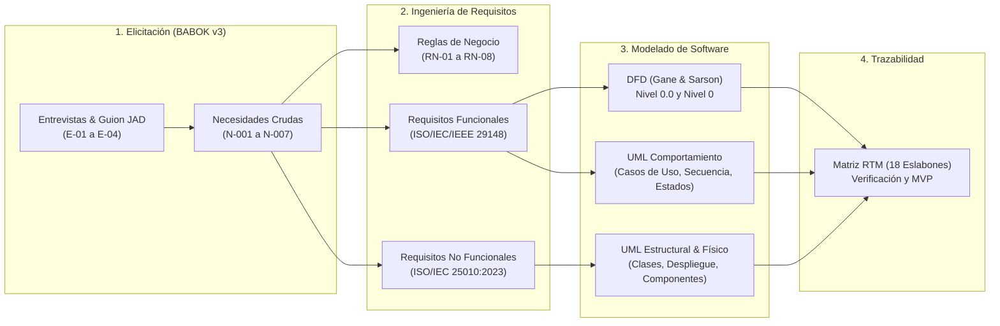
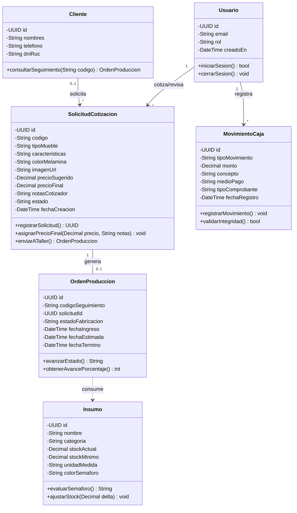
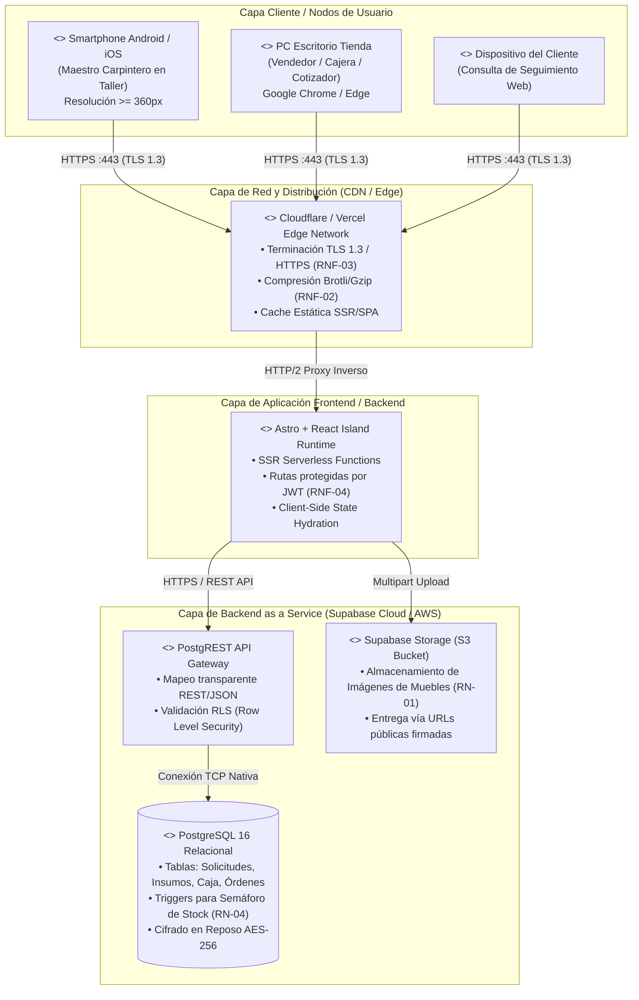
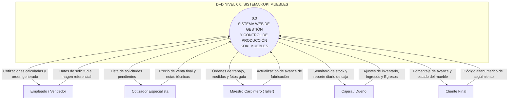
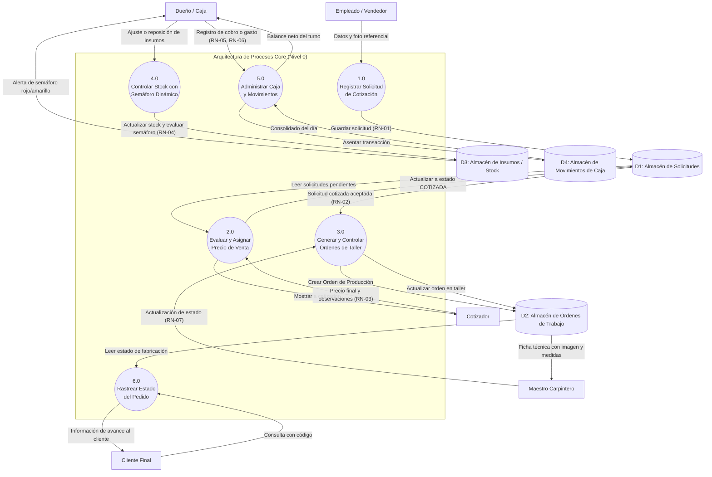
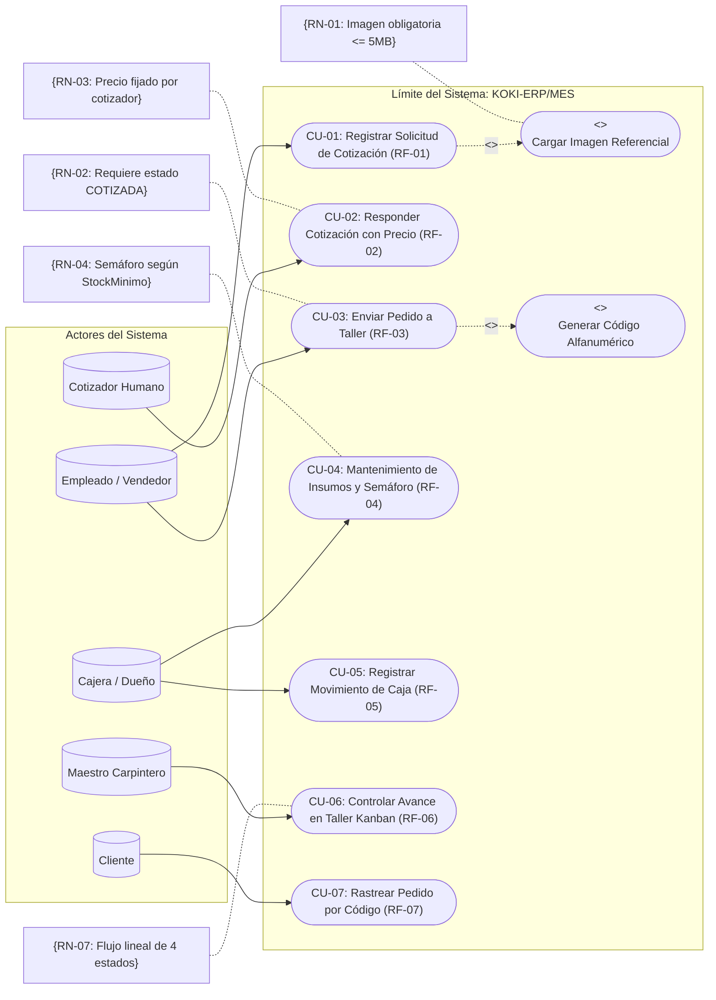
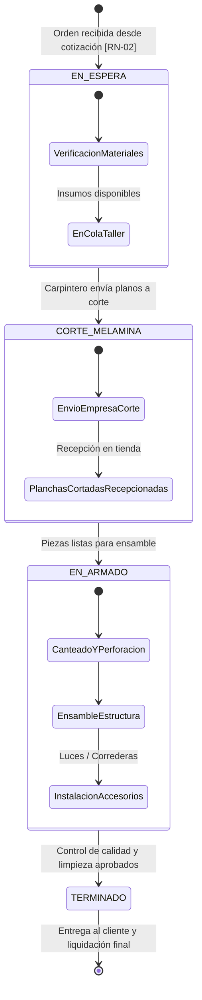
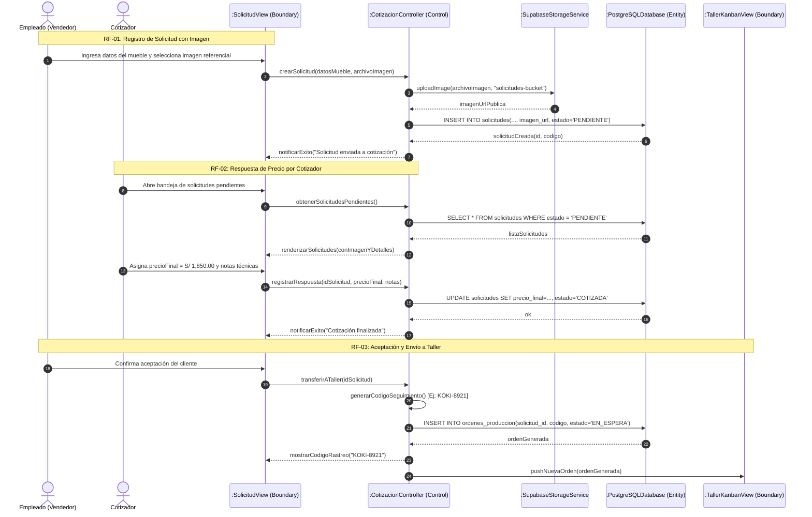

# UNIVERSIDAD NACIONAL JORGE BASADRE GROHMANN
### FACULTAD DE INGENIERÍA
### ESCUELA PROFESIONAL DE INGENIERÍA EN INFORMÁTICA Y SISTEMAS

---

# INFORME DE ANÁLISIS DE SISTEMAS — VERSIÓN CONSOLIDADA V2
## Sistema de Información y Gestión para Mueblería Koki («KOKI-ERP/MES»)

**Estándares Aplicados:**  
* **ISO/IEC/IEEE 29148:2018:** *Requirements Engineering* (Sintaxis estricta, verificación y trazabilidad).  
* **ISO/IEC 25010:2023:** *Product Quality Model* (Cuantificación medible de atributos de calidad).  
* **BABOK v3:** *Business Analysis Body of Knowledge* (Elicitación, Stakeholders y RTM).  
* **OMG UML 2.5.1:** *Unified Modeling Language Specification*.  
* **RUP + Scrum:** Metodología híbrida orientada al desarrollo incremental de un MVP web.

**Integrantes:**
* Fernando Jesús Briceño (2024-119029)
* Josué Fernando Mamani Lima (2025-119055)
* Alexander Tellez Mesa (2024-119038)
* Jhon Jesús Huarcaya Cardoza (2025-119027)

**Docente / Curso:** Análisis de Sistemas  
**Tacna — Perú, 2026**

---

## ÍNDICE GENERAL DEL DOCUMENTO

1. **Introducción y Contexto Organizacional**
2. **Objetivos del Proyecto (General y Específicos)**
3. **Marco Conceptual y Metodológico**
4. **Metodología de Elicitación y Análisis**
5. **Resultados del Análisis de Negocio**
   * 5.1 Situación Problemática
   * 5.2 Ficha Formal del Caso y Límites del Sistema
   * 5.3 Matriz de Stakeholders (ST-001 a ST-006)
   * 5.4 Síntesis de Evidencias de Elicitación
   * 5.5 Registro de Necesidades Crudas (N-001 a N-007)
   * 5.6 Requisitos de Usuario (RU-01 a RU-07)
   * 5.7 Catálogo de Reglas de Negocio (RN-01 a RN-08)
   * 5.8 Requisitos Funcionales bajo ISO/IEC/IEEE 29148 (RF-01 a RF-07)
   * 5.9 Requisitos No Funcionales bajo ISO/IEC 25010:2023 (RNF-01 a RNF-07)
6. **Modelado del Sistema (Diagramas Estructurales, DFD y de Comportamiento)**
   * 6.1 Guía Maestra de Ubicación y Tipología de Diagramas
   * 6.2 Diagramas Estructurales Globales
     * 6.2.1 Diagrama de Clases del Dominio
     * 6.2.2 Diagrama de Despliegue Físico y Seguridad
     * 6.2.3 Diagrama de Arquitectura de Paquetes / Módulos
   * 6.3 Diagramas de Flujo de Datos (DFD)
     * 6.3.1 DFD Nivel 0.0 (Contexto del Sistema)
     * 6.3.2 DFD Nivel 0 (Arquitectura de Procesos Core y Almacenes)
   * 6.4 Diagramas de Comportamiento UML por Requisito Funcional
     * 6.4.1 Diagrama General de Casos de Uso (UML 2.5.1)
     * 6.4.2 Diagrama de Máquina de Estados (Ciclo de Vida de Pedido y Taller)
     * 6.4.3 Diagrama de Secuencia: Solicitud, Cotización y Envío a Taller (RF-01 a RF-03)
     * 6.4.4 Diagrama de Actividades: Mantenimiento de Stock con Semáforo y Caja (RF-04 y RF-05)
7. **Matriz de Trazabilidad de Requisitos (RTM Bidireccional)**
8. **Relación con el MVP Desarrollado (Astro + React + Supabase)**
9. **Discusión de Decisiones de Diseño**
10. **Conclusiones y Recomendaciones**

---

## 1. INTRODUCCIÓN

La gestión operativa de una empresa dedicada a la fabricación y comercialización de muebles a medida en melamina exige una rigurosa coordinación entre la atención comercial, la cotización técnica, el control de stock de insumos, las órdenes de producción en taller y el balance diario de caja. En **Mueblería Koki** (Tacna, Perú), estos procesos se han realizado históricamente mediante registros manuales en cuadernos, comunicación no estructurada vía WhatsApp y estimaciones empíricas de stock. Dicho esquema genera retrasos frecuentes, discrepancias de medidas, falta de visibilidad del estado de los pedidos y riesgo constante de quiebres de inventario.

El presente documento consolida la **Versión 2 (V2)** del Informe de Análisis de Sistemas. Esta versión fusiona la estructura académica, el análisis de stakeholders y la validación empírica con el MVP (desarrollado en Astro/React y Supabase) con el rigor formal de los estándares internacionales **ISO/IEC/IEEE 29148** para la especificación de requisitos funcionales, **ISO/IEC 25010:2023** para la cuantificación medible de atributos de calidad de software, y **OMG UML 2.5.1** junto con **DFD** para el modelado integral.

---

## 2. OBJETIVOS

### 2.1. Objetivo General
Analizar, especificar y modelar el sistema de información para la gestión de cotizaciones, inventario, órdenes de producción en taller y control de caja de **Mueblería Koki**, garantizando la trazabilidad integral desde las necesidades de los interesados hasta la arquitectura de software desplegada en un MVP web.

### 2.2. Objetivos Específicos
1. Identificar la situación problemática, caracterizar a los stakeholders y estructurar las evidencias de elicitación mediante entrevistas y observación directa.
2. Formular formalmente las necesidades crudas y los requisitos de usuario, abstrayendo las políticas organizacionales en un catálogo de **Reglas de Negocio (RN)** independientes.
3. Especificar los **Requisitos Funcionales (RF)** bajo la sintaxis normativa de **ISO/IEC/IEEE 29148** y los **Requisitos No Funcionales (RNF)** cuantificados bajo las características de calidad de **ISO/IEC 25010:2023**.
4. Elaborar el modelado completo del sistema mediante Diagramas de Flujo de Datos (**DFD Contexto 0.0 y Nivel 0**) y diagramas **UML 2.5.1** (Clases, Despliegue, Paquetes, Casos de Uso, Estados, Secuencia y Actividades).
5. Construir la **Matriz de Trazabilidad de Requisitos (RTM)** que valide la correspondencia biunívoca entre problemas del negocio, requisitos, artefactos de diseño y componentes implementados en el MVP.

---

## 3. MARCO CONCEPTUAL Y METODOLÓGICO



* **ISO/IEC/IEEE 29148:2018:** Establece que los requisitos de software deben ser necesarios, no ambiguos, consistentes, verificables y expresados en una estructura canónica obligatoria:  
  $$\text{[ID]} + \text{«El sistema deberá»} + \text{[Verbo en Infinitivo]} + \text{[Objeto Directo]} + \text{[Condición / Regla de Negocio]}$$
* **ISO/IEC 25010:2023:** Modelo de calidad que sustituye adjetivos subjetivos (*"rápido"*, *"amigable"*) por métricas operativas con umbrales medibles en eficiencia de desempeño, seguridad, usabilidad, fiabilidad y mantenibilidad.
* **Separación de Reglas de Negocio (BABOK v3):** Las políticas, fórmulas y límites operativos existen fuera del software; el sistema es solo el instrumento para su cumplimiento estricto.

---

## 4. METODOLOGÍA DE ELICITACIÓN Y ANÁLISIS

El proceso de elicitación se estructuró en tres técnicas combinadas:
1. **Entrevista Semiestructurada:** Basada en el cuestionario de 13 preguntas estratégicas aplicado al dueño de la empresa y a los operarios clave (Vendedor, Cajera, Carpintero).
2. **Observación Directa en Taller y Tienda (O-01):** Verificación de los cuellos de botella en la entrega de bosquejos en papel y el cálculo manual de planchas de melamina.
3. **Revisión de Artefactos Existentes:** Cuaderno de apuntes de ventas, notas de entrega y fichas de corte enviadas a la empresa externa de corte.

---

## 5. RESULTADOS DEL ANÁLISIS DE NEGOCIO

### 5.1. Situación Problemática
Mueblería Koki presenta saturación y demoras críticas en días de alta afluencia comercial:
* **Área Comercial:** Pérdida de prospectos debido a demoras de hasta 40 minutos en proporcionar un precio de mueble personalizado.
* **Área de Producción:** Errores de corte y ensamble ocasionados por notas a mano ilegibles o falta de imágenes de referencia en el taller.
* **Área de Inventario:** Quiebres imprevistos de stock en accesorios clave (bisagras, correderas telescópicas, perfiles de aluminio y luces LED) por falta de un control sistemático de niveles mínimos.
* **Área de Caja:** Riesgo de descuadres monetarios al consolidar pagos presenciales (efectivo), billeteras digitales (Yape/Plin) y transferencias en un cuaderno sin validación de comprobantes.
* **Atención al Cliente:** Interrupción constante del trabajo en tienda debido a llamadas repetitivas de clientes consultando el estado de fabricación de sus pedidos.

---

### 5.2. Ficha Formal del Caso y Límites del Sistema

| Campo Metodológico | Descripción / Especificación del Proyecto |
| :--- | :--- |
| **Nombre del Sistema** | **KOKI-ERP/MES** (Módulo Web de Ventas, Cotizaciones, Inventario, Taller y Caja). |
| **Organización / Contexto** | Mueblería Koki — Empresa familiar de diseño, fabricación y venta de muebles a medida en melamina (Tacna, Perú). |
| **Problema Principal** | Control manual e inconexo de pedidos, inventario y finanzas en cuadernos y chats informales; sobrecarga en caja; falta de claridad en órdenes de trabajo e incertidumbre para el cliente. |
| **Objetivo del Análisis** | Comprender y formalizar los requisitos para el desarrollo y puesta en producción de un sistema web integral (MVP) de cotización, control de insumos, seguimiento kanban de producción y monitoreo de caja. |
| **Usuarios Principales** | Dueño/Administrador, Cotizador Especialista, Vendedor/Empleado de Tienda, Cajera, Maestro Carpintero (Taller) y Cliente Final (Portal de Seguimiento). |
| **Proceso Principal (Core)** | **Flujo Integral del Pedido a Medida:** Solicitud con imagen referencial $\rightarrow$ Cotización técnica y precio final $\rightarrow$ Aprobación y orden de trabajo $\rightarrow$ Ejecución en taller (Corte / Armado) $\rightarrow$ Entrega y balance de caja. |
| **Alcance Inicial (In-Scope - MVP)** | • Registro de solicitudes de cotización con imagen obligatoria y características técnicas.<br>• Bandeja de cotización para fijar precio final y notas del cotizador.<br>• Conversión de cotización aceptada a orden de trabajo para taller.<br>• Panel visual de control de órdenes de taller (flujo de estados).<br>• Módulo de inventario de insumos con semáforo automatizado de stock.<br>• Registro y balance diario de movimientos de caja (ingresos/egresos por medio de pago).<br>• Portal web público de rastreo de pedidos mediante código único. |
| **Fuera de Alcance (Out-of-Scope)** | • Integración telemática con GPS para seguimiento de vehículos en mapa satelital.<br>• Emisión directa de factura electrónica con envío automático al webservice OSE/SUNAT (en esta fase se emite comprobante local boleta/factura/boleta simple).<br>• Despiece automático asistido por software de corte CNC.<br>• Aplicación móvil nativa (Android/iOS) — el sistema se diseñará como Web Responsive. |
| **Supuestos y Restricciones** | • Personal operativo con competencias informáticas básicas.<br>• Acceso a internet en taller mayoritariamente mediante datos móviles de operadoras.<br>• Disponibilidad de una PC de escritorio en tienda y dispositivos móviles personales en taller. |

---

### 5.3. Matriz de Stakeholders (ST)

| ID | Stakeholder / Rol | Descripción de Responsabilidad | Interés Principal en el Sistema | Nivel de Influencia | Prioridad | Fuente de Elicitación |
| :---: | :--- | :--- | :--- | :---: | :---: | :---: |
| **ST-001** | **Dueño de la Empresa** | Dirección general, decisiones financieras y de aprovisionamiento. | Monitorear ingresos netos diarios, ventas totales y stock crítico sin cuadernos físicos. | Alta | Alta | Entrevista E-01 |
| **ST-002** | **Cotizador Especializado** | Maestro técnico o socia con experiencia en costos y despieces. | Recibir solicitudes completas (datos + foto) y registrar el precio final sugerido/definitivo. | Alta | Alta | Entrevista E-02 |
| **ST-003** | **Empleado / Vendedor** | Atención en tienda física y canal WhatsApp; recepción de clientes. | Cotizar rápidamente, consultar disponibilidad y enviar órdenes confirmadas a taller. | Media | Alta | Observación O-01 |
| **ST-004** | **Maestro Carpintero** | Jefe de taller responsable del armado, ensamble y acabados. | Contar con órdenes claras, especificaciones milimétricas e imagen referencial para armar. | Media | Alta | Entrevista E-03 |
| **ST-005** | **Cajera / Contabilidad** | Recepción de dinero presencial/digital y emisión de comprobantes. | Organizar cobros de anticipos, balance de arqueo diario y clasificación por medio de pago. | Media | Alta | Entrevista E-01 |
| **ST-006** | **Cliente Final** | Comprador del mueble a medida. | Conocer el avance de fabricación de su mueble en tiempo real mediante un código web. | Media | Media | Encuesta C-01 |

---

### 5.4. Síntesis de Evidencias de Elicitación

De las entrevistas y observaciones en el local de Mueblería Koki se consolidan las siguientes evidencias trazables:
* **E-01 (Canal y Registro):** Más del 70% de las operaciones se inician presencialmente y se complementan por fotos enviadas a WhatsApp. El uso de cuadernos manuscritos genera duplicidad de registros y extravío de pedidos.
* **E-02 (Criterio de Cotización):** El cálculo considera planchas de melamina, canto grueso/delgado, herrajes, accesorios de lujo (LED, espejos) y margen de utilidad. La dueña/maestro siempre valida el precio final antes de cerrar el trato.
* **E-03 (Taller y Producción):** Los retrasos más severos se originan por falta de la imagen de referencia al momento de ensamblar en taller o dudas sobre el color exacto de melamina solicitado por el cliente.
* **E-04 (Conectividad e Infraestructura):** En el taller no existe cableado de red local; los operarios acceden mediante smartphones con conexión 4G comercial. La interfaz debe ser liviana y operable en pantallas reducidas.

---

### 5.5. Registro de Necesidades Crudas del Negocio (N)

| ID | Stakeholder | Expresión de Necesidad Cruda | Evidencia / Causa Raíz | Impacto Operativo |
| :---: | :--- | :--- | :---: | :--- |
| **N-001** | Dueño / Caja | Centralizar el registro de ventas, compras y balance financiero diario. | E-01 (Preg. 11, 12) | Cuaderno físico propenso a pérdidas, borrones y descuadres de caja. |
| **N-002** | Empleado / Vendedor | Contar con un canal directo para enviar solicitudes de precio al cotizador. | E-01 (Preg. 2, 3) | Precios no estandarizados y pérdida de clientes por demora en la cotización. |
| **N-003** | Cotizador | Recibir solicitudes con datos técnicos completos e imagen de diseño obligatoria. | E-02 (Preg. 8) | Incertidumbre al calcular material sin tener a la vista el modelo del mueble. |
| **N-004** | Maestro Carpintero | Disponer de órdenes de trabajo con detalles de color, medidas y foto de guía. | E-03 (Preg. 8, 9) | Desensamble por interpretaciones erróneas y retrasos en entrega. |
| **N-005** | Dueño / Taller | Disponer de un inventario dinámico con semáforo visual para reponer insumos. | E-01 (Preg. 5, 6) | Paradas imprevistas de fabricación al agotarse insumos críticos no avisados. |
| **N-006** | Cajera | Registrar de manera independiente ingresos y egresos según medio de pago. | E-01 (Preg. 11) | Dificultad para conciliar dinero en efectivo con depósitos en Yape/Plin. |
| **N-007** | Cliente Final | Conocer en qué etapa de fabricación se encuentra su mueble sin llamar a tienda. | E-01 (Preg. 10) | Saturación telefónica de los vendedores atendiendo llamadas de consulta. |

---

### 5.6. Requisitos de Usuario (RU)

| ID | Actor Primario | Declaración del Requisito de Usuario (*User Requirement*) | Propósito del Usuario |
| :---: | :--- | :--- | :--- |
| **RU-01** | Empleado | Registrar el tipo de mueble, medidas estimadas, color de melamina e imagen referencial para remitir al cotizador. | Iniciar el proceso de venta con información técnica completa. |
| **RU-02** | Cotizador | Visualizar la cola de solicitudes pendientes y asignar el precio de venta final junto con notas técnicas aclaratorias. | Establecer precios consistentes asegurando el margen del negocio. |
| **RU-03** | Empleado | Consultar la cotización aprobada y, previa confirmación del cliente, enviar la orden de trabajo a taller. | Formalizar la orden y comprometer la fecha de fabricación. |
| **RU-04** | Dueño / Almacenero | Gestionar insumos (altas, modificaciones, ajustes) y consultar el estado del semáforo de inventario. | Evitar el quiebre de stock de melamina y herrajes esenciales. |
| **RU-05** | Cajera / Dueño | Registrar ingresos y egresos diarios, seleccionando comprobante y medio de pago, y consultar el balance diario. | Mantener el arqueo transparente y controlado por turnos. |
| **RU-06** | Maestro Carpintero | Visualizar el panel kanban de órdenes y avanzar el estado de fabricación (Espera $\rightarrow$ Corte $\rightarrow$ Armado $\rightarrow$ Listo). | Organizar el flujo físico de ensamble y notificar el avance del mueble. |
| **RU-07** | Cliente Final | Ingresar a una página web y digitar su código único de seguimiento para ver el estado de su pedido. | Obtener transparencia y tranquilidad sobre la fecha de entrega. |

---

### 5.7. Catálogo de Reglas de Negocio (RN)

> [!IMPORTANT]
> **Definición de Reglas de Negocio (RN):** Son directrices obligatorias de gobernanza, políticas de operación y restricciones del negocio que el software debe hacer cumplir de forma estricta.

* **RN-01 (Imagen Referencial Obligatoria):**  
  Toda solicitud de cotización de mueble a medida debe incluir obligatoriamente al menos un archivo de imagen (formato JPEG, PNG o WebP, tamaño máximo de 5 MB) para permitir la evaluación visual del cotizador y carpintero.
* **RN-02 (Condición de Envío a Taller):**  
  Ninguna orden puede ser enviada al módulo de taller si su estado previo no es `COTIZADA` y aceptada por el cliente con el registro de su anticipo correspondiente.
* **RN-03 (Autoridad de Fijación de Precios):**  
  El precio final del mueble es fijado de forma exclusiva por el cotizador humano autorizado. Cualquier cálculo algorítmico o paramétrico es considerado únicamente como valor sugerido de referencia.
* **RN-04 (Algoritmo de Semáforo de Stock de Insumos):**  
  Para todo insumo o material registrado en almacén:
  $$\text{Semáforo} = \begin{cases} 
  \mathbf{ROJO} & \text{si } StockActual \le StockMinimo \\ 
  \mathbf{AMARILLO} & \text{si } StockMinimo < StockActual \le 1.5 \times StockMinimo \\ 
  \mathbf{VERDE} & \text{si } StockActual > 1.5 \times StockMinimo 
  \end{cases}$$
* **RN-05 (Integridad Transaccional de Caja):**  
  Todo movimiento de caja registrado debe clasificarse obligatoriamente como `INGRESO` o `EGRESO`, con un importe numérico estrictamente mayor a cero ($Monto > 0.00$).
* **RN-06 (Tipología de Comprobantes de Pago):**  
  Los comprobantes asociados a movimientos de caja se limitan a tres tipos fiscales internos: `BOLETA`, `FACTURA` y `BOLETA_SIMPLE` (recibo de control interno de la empresa).
* **RN-07 (Progresión Lineal de Estados de Fabricación):**  
  El ciclo operativo en taller sigue una máquina de estados estrictamente secuencial y no reversible sin autorización administrativa:  
  $$\text{EN\_ESPERA} \longrightarrow \text{CORTE\_MELAMINA} \longrightarrow \text{EN\_ARMADO} \longrightarrow \text{TERMINADO}$$
* **RN-08 (Medios de Pago Admitidos):**  
  Los cobros y pagos válidos en el sistema deben clasificarse dentro del catálogo cerrado: `EFECTIVO`, `YAPE`, `PLIN`, `TRANSFERENCIA` y `TARJETA`.

---

### 5.8. Especificación de Requisitos Funcionales (ISO/IEC/IEEE 29148)

> **Sintaxis Estricta Aplicada:**  
> `[ID] El sistema deberá + [Verbo Infinitivo] + [Objeto del Requisito] + [Condición / Regla de Negocio]`

| ID | Declaración Normativa del Requisito Funcional (ISO 29148) | Regla Asociada | Prioridad | Módulo MVP |
| :---: | :--- | :---: | :---: | :---: |
| **RF-01** | **El sistema deberá registrar** solicitudes de cotización de muebles capturando tipo de mueble, dimensiones aproximadas, color de melamina, especificaciones técnicas y la carga obligatoria del archivo de imagen referencial. | **RN-01** | Alta | Solicitudes |
| **RF-02** | **El sistema deberá permitir** al cotizador autorizado listar las solicitudes pendientes y registrar el precio final de venta y notas técnicas de respuesta. | **RN-03** | Alta | Cotización |
| **RF-03** | **El sistema deberá convertir** solicitudes en estado cotizado a órdenes de producción de taller, generando un código alfanumérico único de seguimiento para el cliente. | **RN-02** | Alta | Órdenes / Taller |
| **RF-04** | **El sistema deberá gestionar** el inventario de insumos (registro, actualización de cantidad y baja lógica) y calcular dinámicamente el color del semáforo de abastecimiento. | **RN-04** | Alta | Inventario |
| **RF-05** | **El sistema deberá registrar y calcular** los movimientos diarios de caja (entradas y salidas de dinero), clasificándolos por medio de pago admitido y emitiendo el balance neto consolidado en tiempo real. | **RN-05, RN-06, RN-08** | Alta | Caja y Balance |
| **RF-06** | **El sistema deberá visualizar y actualizar** el estado de las órdenes de trabajo en el panel de taller conforme avance la manufactura del mueble siguiendo el flujo lineal definido. | **RN-07** | Alta | Taller Kanban |
| **RF-07** | **El sistema deberá consultar y presentar** públicamente el estado actual de fabricación y datos informativos del pedido a cualquier usuario que ingrese un código de seguimiento válido. | — | Media | Portal Rastreo |

---

### 5.9. Especificación de Requisitos No Funcionales (ISO/IEC 25010:2023)

| ID | Característica / Subcaracterística | Métrica y Umbral Operacional Verificable (Cuantificación) | Método de Medición / Prueba |
| :---: | :--- | :--- | :--- |
| **RNF-01** | **Eficiencia de Desempeño**<br>*(Comportamiento Temporal)* | El tiempo de respuesta del servidor en transacciones de lectura/escritura debe ser **$\le 1.5\text{ segundos}$** en el percentil 95 ($P_{95}$) bajo una carga simultánea de **hasta 50 usuarios concurrentes**. | Ejecución de scripts automatizados de prueba de carga con k6 o JMeter en entorno de staging. |
| **RNF-02** | **Eficiencia de Desempeño**<br>*(Consumo de Recursos)* | El peso total de la carga inicial de assets (HTML, CSS compilado, JS y fuentes) no debe superar **$350\text{ KB}$** en vista de cliente móvil con throttling emulado de 4G/3G. | Auditoría técnica con Google Lighthouse y Chrome DevTools Network Tab. |
| **RNF-03** | **Seguridad**<br>*(Confidencialidad e Integridad)* | Todo el tráfico web debe forzarse mediante protocolo seguro **HTTPS sobre TLS 1.3**; la persistencia de datos en Supabase debe aplicar políticas **RLS (Row Level Security)**. | Escaneo de configuración SSL (calificación mínima A en SSL Labs) y pruebas de inyección en API. |
| **RNF-04** | **Seguridad**<br>*(Autenticación y Autorización)* | El acceso a módulos administrativos y de cotización debe protegerse mediante autenticación basada en tokens JWT con expiración automática tras **30 minutos de inactividad**. | Pruebas de verificación de expiración de sesión y autorización por endpoint. |
| **RNF-05** | **Usabilidad**<br>*(Diseño y Adaptabilidad)* | La interfaz web debe ser **100% responsiva (Mobile First)**, adaptándose dinámicamente a resoluciones de pantalla a partir de **$360\text{px}$** de ancho horizontal. | Pruebas visuales en dispositivos móviles reales (Android / iOS) e inspección responsiva. |
| **RNF-06** | **Fiabilidad**<br>*(Disponibilidad Operativa)* | El sistema debe garantizar una disponibilidad de servicio no menor al **$99.5\%$ durante la jornada comercial** (Lunes a Sábado, de 08:00 a 20:00 horas locales). | Monitoreo sintético continuo con UptimeRobot / Pingdom con alertas a Slack/Telegram. |
| **RNF-07** | **Mantenibilidad**<br>*(Modularidad y Desacoplamiento)* | El código frontend y backend debe estructurarse en capas desacopladas (Presentación, Servicios API, Repositorio Supabase) con cobertura de pruebas unitarias **$\ge 70\%$ en utilitarios core**. | Ejecución de suite de tests en Vitest/Jest integrada en el pipeline de GitHub Actions. |

---

## 6. MODELADO DEL SISTEMA

### 6.1. Guía Maestra de Ubicación y Tipología de Diagramas

Para garantizar que el informe cumpla con el estándar de evaluación académica y profesional, la siguiente tabla detalla **qué diagrama va en cada sección**, su propósito y los elementos indispensables:

| Sección en Informe | Nombre del Diagrama | Estándar / Notación | Propósito Arquitectónico y Elementos Obligatorios |
| :---: | :--- | :---: | :--- |
| **6.2.1** | **Diagrama de Clases del Dominio** | OMG UML 2.5.1 | Modela las entidades de datos persistentes (`Usuario`, `SolicitudCotizacion`, `Insumo`, `MovimientoCaja`, `Pedido`, `OrdenProduccion`, `Cliente`), sus atributos con visibilidad (`-`), métodos (`+`) y multiplicidad de asociaciones (`1..*`, `0..1`). |
| **6.2.2** | **Diagrama de Despliegue Físico** | OMG UML 2.5.1 | Representa los nodos de cómputo físicos/nube (`<<device>>`), entornos de ejecución (`<<executionEnvironment>>`), artefactos (`<<artifact>>`) y los canales de comunicación seguros (**HTTPS/TLS 1.3**, WebSockets, TCP) que satisfacen los RNF de rendimiento y seguridad. |
| **6.2.3** | **Diagrama de Paquetes / Módulos** | OMG UML 2.5.1 | Visualiza el desacoplamiento de la arquitectura en capas (`Presentation`, `Application Services`, `Domain Core`, `Infrastructure BaaS`) y las dependencias unidireccionales entre paquetes. |
| **6.3.1** | **DFD Nivel 0.0 (Contexto)** | Gane & Sarson | Representa el sistema completo como una sola burbuja de proceso central (`0.0`), mostrando únicamente las Entidades Externas y los flujos globales de datos que entran y salen. *Prohibido colocar almacenes en este nivel.* |
| **6.3.2** | **DFD Nivel 0 (Arquitectura de Procesos)** | Gane & Sarson | Descompone el proceso `0.0` en los procesos core numerados (`1.0 Solicitudes`, `2.0 Cotizaciones`, `3.0 Taller`, `4.0 Inventario`, `5.0 Caja`), conectándolos con las entidades externas y los almacenes de datos identificados (`D1` a `D5`). |
| **6.4.1** | **Diagrama de Casos de Uso General** | OMG UML 2.5.1 | Define el límite del sistema (*System Boundary*), los Actores del negocio y los óvalos de casos de uso (`CU-01` a `CU-07`), modelando relaciones `<<include>>`, `<<extend>>` y notas adosadas con restricciones `{RN-XX}`. |
| **6.4.2** | **Diagrama de Máquina de Estados** | OMG UML 2.5.1 | Describe el ciclo de vida del pedido y la progresión secuencial en taller desde su concepción hasta su terminación, detallando eventos desencadenantes y condiciones de guarda `[guarda]`. |
| **6.4.3** | **Diagrama de Secuencia BCE** | OMG UML 2.5.1 | Ilustra la interacción temporal de mensajes para los requisitos más complejos (`RF-01`, `RF-02`, `RF-03`), segregando las líneas de vida en roles Boundary (`UI`), Control (`Controller/Service`) y Entity (`DB/PostgreSQL`). |
| **6.4.4** | **Diagrama de Actividades** | OMG UML 2.5.1 | Modela los flujos de control paralelos y decisiones lógicas condicionales (*swimlanes* por actor), específico para la evaluación del semáforo de inventario y el balance de caja. |

---

### 6.2. Diagramas Estructurales Globales

#### 6.2.1. Diagrama de Clases del Dominio Koki Muebles (UML 2.5.1)
*Ubicación sugerida:* Subsección 6.1.1 del informe formal.



---

#### 6.2.2. Diagrama de Despliegue Físico y Topología de Red (UML 2.5.1)
*Ubicación sugerida:* Subsección 6.1.2 del informe formal. Este diagrama demuestra el cumplimiento de los **RNF-01 (Rendimiento)**, **RNF-03 (Seguridad TLS 1.3)** y **RNF-05 (Responsive)**.



---

#### 6.2.3. Diagrama de Paquetes y Módulos de la Arquitectura
*Ubicación sugerida:* Subsección 6.1.3 del informe formal.

```mermaid
flowchart TD
    subgraph PresentationLayer["1. Capa de Presentación (Frontend UI / Astro + React)"]
        P_Views["Módulos de Vistas:<br/>• /cotizaciones<br/>• /taller-kanban<br/>• /inventario-stock<br/>• /caja-diaria<br/>• /rastreo-publico"]
        P_Components["Componentes Compartidos:<br/>• ImageUploader<br/>• SemaforoBadge<br/>• KanbanCard<br/>• MoneyInput"]
    end

    subgraph ApplicationLayer["2. Capa de Aplicación / Controladores"]
        A_CotizacionService["CotizacionService"]
        A_TallerService["TallerService"]
        A_InventarioService["InventarioService"]
        A_CajaService["CajaService"]
        A_RastreoService["RastreoService"]
    end

    subgraph DomainLayer["3. Capa de Dominio (Entidades y Reglas de Negocio)"]
        D_Rules["Motor de Reglas:<br/>• RN-01 (Validación Imagen)<br/>• RN-04 (Cálculo Semáforo)<br/>• RN-05 (Validación Caja)"]
        D_Entities["Modelos de Datos:<br/>Solicitud, Insumo, Movimiento, Orden"]
    end

    subgraph InfrastructureLayer["4. Capa de Infraestructura (Persistencia y Cloud)"]
        I_SupabaseClient["Supabase Database Client (PostgreSQL)"]
        I_StorageClient["Supabase Storage Service (Imágenes S3)"]
    end

    PresentationLayer --> ApplicationLayer
    ApplicationLayer --> DomainLayer
    ApplicationLayer --> InfrastructureLayer
    InfrastructureLayer ..> DomainLayer
```

---

### 6.3. Diagramas de Flujo de Datos (DFD)

#### 6.3.1. DFD Nivel 0.0 (Diagrama de Contexto del Sistema)
*Ubicación sugerida:* Subsección 6.2 del informe formal.  
*Regla de validación:* Solo 1 proceso global `0.0`, únicamente Entidades Externas, **cero almacenes de datos**.



---

#### 6.3.2. DFD Nivel 0 (Arquitectura de Procesos Core y Almacenes)
*Ubicación sugerida:* Subsección 6.3 del informe formal.  
*Regla de validación:* Desglose en procesos `1.0` a `5.0` con entidades externas y almacenes `D1` a `D5`.



---

### 6.4. Diagramas de Comportamiento UML por Requisito Funcional

#### 6.4.1. Diagrama General de Casos de Uso del Sistema (UML 2.5.1)
*Ubicación sugerida:* Subsección 6.4.1 del informe formal. Modela todos los RF y su interacción con los actores.



---

#### 6.4.2. Diagrama de Máquina de Estados: Ciclo de Fabricación en Taller (RF-03, RF-06)
*Ubicación sugerida:* Subsección 6.4.2 del informe formal. Sustenta la regla de negocio **RN-07**.



---

#### 6.4.3. Diagrama de Secuencia BCE: Flujo Solicitud $\rightarrow$ Cotización $\rightarrow$ Taller (RF-01 a RF-03)
*Ubicación sugerida:* Subsección 6.4.3 del informe formal.



---

#### 6.4.4. Diagrama de Actividades: Evaluación de Semáforo de Insumos y Caja (RF-04, RF-05)
*Ubicación sugerida:* Subsección 6.4.4 del informe formal.

```mermaid
flowchart TD
    subgraph Actividad_Inventario["Flujo de Mantenimiento de Stock (RF-04)"]
        A1([Inicio: Cambio en Inventario]) --> A2[Ingresar cantidad física de insumo]
        A2 --> A3[Guardar nuevo Stock Actual en Base de Datos]
        A3 --> A4{¿StockActual <= StockMinimo?}
        A4 -- Sí --> A5[Asignar Color: ROJO<br/>Generar Alerta de Reabastecimiento Urgente]
        A4 -- No --> A6{¿StockActual <= 1.5 * StockMinimo?}
        A6 -- Sí --> A7[Asignar Color: AMARILLO<br/>Generar Advertencia Preventiva]
        A6 -- No --> A8[Asignar Color: VERDE<br/>Nivel Óptimo Operativo]
        A5 --> A9([Fin Inventario])
        A7 --> A9
        A8 --> A9
    end

    subgraph Actividad_Caja["Flujo de Movimiento de Caja Diaria (RF-05)"]
        B1([Inicio: Registro de Transacción]) --> B2[Ingresar Monto, Concepto y Medio de Pago]
        B2 --> B3{¿Monto > 0.00?}
        B3 -- No --> B4[Rechazar Transacción: Error RN-05]
        B3 -- Sí --> B5{¿Tipo de Movimiento?}
        B5 -- Ingreso --> B6[Seleccionar Comprobante: Boleta / Factura / Boleta Simple]
        B5 -- Egreso --> B7[Registrar Gasto de Operación / Compra Insumo]
        B6 --> B8[Recalcular Balance Neto = Ingresos - Egresos]
        B7 --> B8
        B8 --> B9[Actualizar Panel de Monitoreo Diario]
        B9 --> B10([Fin Caja])
        B4 --> B10
    end
```



---

## 7. MATRIZ DE TRAZABILIDAD DE REQUISITOS (RTM BIDIRECCIONAL)

La siguiente matriz establece la trazabilidad de extremo a extremo, vinculando las fuentes del negocio con los requisitos, los modelos de software y el estado en el producto ejecutable (MVP):

| Módulo | Necesidad Cruda | Requisito Usuario | Regla Negocio | Requisito Funcional (ISO 29148) | Requisito No Funcional (ISO 25010) | Diagramas DFD | Diagramas UML Asignados | Caso de Prueba / Verificación | Estado MVP |
| :--- | :---: | :---: | :---: | :---: | :---: | :---: | :---: | :---: | :---: |
| **Solicitudes** | N-002, N-003 | RU-01 | RN-01 | **RF-01** | RNF-02, RNF-05 | DFD 0.0, DFD 1.0 | CU-01, Secuencia BCE, Clases | CP-SOL-01: Rechazo si no adjunta imagen | **Completado** |
| **Cotización** | N-002 | RU-02 | RN-03 | **RF-02** | RNF-01 ($\le 1.5\text{s}$) | DFD 0.0, DFD 2.0 | CU-02, Secuencia BCE | CP-COT-01: Asignación de precio por cotizador | **Completado** |
| **Envío Taller**| N-004 | RU-03 | RN-02 | **RF-03** | RNF-03 (TLS 1.3) | DFD 0.0, DFD 3.0 | CU-03, Secuencia BCE, Estados | CP-TAL-01: Envío bloqueado si no está cotizada | **Completado** |
| **Inventario** | N-001, N-005 | RU-04 | RN-04 | **RF-04** | RNF-01, RNF-06 | DFD 0.0, DFD 4.0 | CU-04, Actividades Semáforo | CP-INV-01: Transición automática de colores | **Completado** |
| **Caja Diaria** | N-001, N-006 | RU-05 | RN-05, RN-06, RN-08 | **RF-05** | RNF-04 (Seguridad) | DFD 0.0, DFD 5.0 | CU-05, Actividades Caja | CP-CAJ-01: Validación monto > 0 y medios pago | **Completado** |
| **Producción** | N-004 | RU-06 | RN-07 | **RF-06** | RNF-05 (Mobile First) | DFD 0.0, DFD 3.0 | CU-06, Máquina de Estados | CP-PRD-01: Progresión lineal de los 4 estados | **Completado** |
| **Seguimiento** | N-007 | RU-07 | — | **RF-07** | RNF-01, RNF-02 | DFD 0.0, DFD 6.0 | CU-07, Despliegue Físico | CP-TRK-01: Consulta por código alfanumérico | **Completado** |

---

## 8. RELACIÓN CON EL MVP DESARROLLADO

El análisis de sistemas desarrollado en este documento fue el sustento directo para la construcción del producto mínimo viable (**MVP**) de la empresa:
1. **Stack Tecnológico:**
   * **Frontend:** Framework Astro con componentes interactivos React y estilos mediante Tailwind CSS.
   * **Backend as a Service:** Supabase (proporcionando base de datos relacional PostgreSQL 16, API REST instantánea vía PostgREST y Bucket S3 para las fotos de los muebles).
2. **Módulos Operativos en Producción de Prueba:**
   * **Bandeja de Solicitudes:** Permite al vendedor subir la fotografía y medidas aproximadas.
   * **Bandeja del Cotizador:** Lista solicitudes y permite ingresar el precio pactado y notas técnicas.
   * **Inventario con Semáforo:** Muestra el listado de insumos con badges dinámicos en Verde, Amarillo y Rojo según la fórmula de RN-04.
   * **Monitoreo Diario de Caja:** Registro transaccional de ingresos y egresos con desglose por Efectivo, Yape, Plin y Tarjeta.
   * **Tablero Kanban de Taller:** Tarjetas arrastrables o con botones de avance para los cuatro estados de fabricación.
   * **Portal Web de Rastreo:** Página pública ligera donde el cliente ingresa su código y observa la barra de porcentaje de fabricación.
3. **Mejoras Planificadas para la Siguiente Iteración (Post-MVP):**
   * Automatización del descuento de insumos en el almacén al avanzar una orden a estado `CORTE_MELAMINA`.
   * Implementación de autenticación granular con roles de usuario independientes y contraseñas cifradas.
   * Calibración del cotizador paramétrico automático como soporte asistente para la cotizadora humana.

---

## 9. DISCUSIÓN DE DECISIONES DE DISEÑO

* **Decisión sobre el Cotizador Humano frente al Automático:**  
  Aunque técnicamente es viable programar una fórmula de cotización 100% matemática, la elicitación demostró que la empresa cotiza considerando factores intangibles (complejidad del diseño, tipo de canteado curvo, urgencia del cliente). Por ello, el sistema adoptó la regla **RN-03**, donde el software calcula una referencia, pero el cotizador humano define el precio contractual.
* **Adopción de un Modelo Liviano (Web Responsive) en lugar de App Móvil:**  
  El personal del taller no disponía de almacenamiento suficiente en sus smartphones para instalar una aplicación nativa adicional. La solución de un panel web accesible por navegador móvil cumplió con los requerimientos de adaptabilidad (**RNF-05**) sin fricción de instalación.
* **Separación de Reglas de Negocio:**  
  La formalización de las reglas **RN-01 a RN-08** evitó la ambigüedad en el código fuente. Por ejemplo, al definir de manera formal el rango del semáforo amarillo ($StockMinimo < StockActual \le 1.5 \times StockMinimo$), se eliminó la discusión entre el dueño y los carpinteros respecto a cuándo considerar un insumo en estado preventivo.

---

## 10. CONCLUSIONES Y RECOMENDACIONES

### 10.1. Conclusiones
1. Se diagnosticó y estructuró la situación operativa de Mueblería Koki, transformando problemas reales de pérdida de datos y retrasos en 7 necesidades crudas y 7 requisitos de usuario priorizados.
2. Se formalizaron los requisitos bajo estándares internacionales: los Requisitos Funcionales (**RF-01 a RF-07**) se redactaron bajo la sintaxis estricta de la norma **ISO/IEC/IEEE 29148**, y los Requisitos No Funcionales (**RNF-01 a RNF-07**) fueron cuantificados con umbrales medibles según **ISO/IEC 25010:2023**.
3. Se diseñó el modelado completo del sistema abarcando la perspectiva estructural (Clases, Despliegue, Paquetes), funcional (DFD Contexto 0.0 y Nivel 0) y de comportamiento (Casos de Uso, Máquina de Estados, Secuencia y Actividades), asegurando que ningún requisito funcional carezca de representación gráfica.
4. La Matriz de Trazabilidad de Requisitos (RTM) de 18 eslabones garantizó la coherencia global entre el problema del negocio, los modelos formales y el software ejecutable entregado en el MVP.

### 10.2. Recomendaciones
1. **Validación de Parámetros:** Contrastar periódicamente los márgenes de merma y costos de plancha con el dueño para calibrar el módulo de sugerencia de cotización automática.
2. **Capacitación Operativa:** Realizar sesiones cortas de inducción al personal de taller para consolidar el hábito de actualizar el tablero Kanban en tiempo real al finalizar cada etapa de ensamble.
3. **Mantenimiento de Trazabilidad:** Cada nueva funcionalidad o pantalla que se proyecte en siguientes sprints de Scrum debe registrarse previamente en la Matriz RTM antes de iniciar su codificación.
